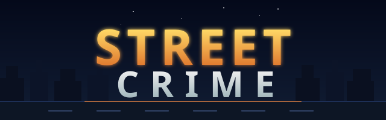

<div align="center">
  
  <br/><br/>

  **[▶ Play now on GitHub Pages](https://isocialpractice.github.io/street-crime/)**

  `Ctrl + click` to view [street-crime documentation](https://isocialpractice.github.io/street-crime/docs/index.html)

</div>

---

> Very much a work-in-progress, but still - this has been a fun project.

A classic 2.5D side-scrolling beat-em-up built entirely in vanilla HTML5 Canvas with no frameworks or dependencies. Take to the streets and fight through waves of criminals to reach the boss.

## Controls

| Action | Keys |
|---|---|
| Move | Arrow keys or WASD |
| Run | Hold Shift + direction |
| Punch | J or Z |
| Kick | K or X |
| Uppercut | J/Z + Up |
| Running Kick | K/X while running |
| Jump | Space |
| Block | Hold C |
| Jump Attack | J/Z or K/X while airborne |
| Enter a door / interact | E, or push into the door (hold Up) |
| Pause | P |

## Features

- 2.5D beat-em-up movement and combat
- Combo system with multiplier display
- Input buffering — attack and jump presses made mid-animation fire the moment the player is free
- Enemy AI with flanking, queued rushing, and attack cooldowns
- Static enemy attacks — flanking enemies swing opportunistically when the player walks into range
- Pause-safe enemy strikes resolved in game time against live positions
- Animated background ambience — neon flicker and streetlight pulses (Stage 1), blinking warning lights and drifting water shimmer (Stage 2), flame flicker and rising embers (Stage 3)
- Unique per-character attack sprites (punch, kick) with frame-hold timing
- Enemy separation — characters spread to strategic positions rather than stacking
- Boss and sub-boss encounters with dedicated health bars
- Breakable objects that drop health pickups
- Data-driven enemy asset animation configuration
- Debug mode with live tuning sliders and sandbox spawning
- Debug Level mode that loads an SVG scene, uses its `#field` shape for walkable bounds, and steps through ordered `section_*` scene panels
- Level map: doors into buildings, breakable scenery, animated signs and no-go areas, all set up by how layers are named in the level SVG (see [Level Map Ids](#level-map-ids))
- Sandbox Test mode for trying one feature at a time, configured from `config/debug/sandbox.json`, with a checklist that ticks as each feature reports in

## Tech

Pure vanilla JavaScript — no build step, no bundler, no dependencies. Open `index.html` in a browser and play.

Enemy asset wiring now lives in `config/enemy-assets.json`, while gameplay tuning remains in `config/enemies.json`.

Tuning lives in three files, `config/configuration.json`, `config/enemies.json` and `config/objects.json`, laid over the built-in values in `js/core/config.js` at startup, in that order. Debug mode's export buttons write those files. `config/defaults/` holds the same three files as the game ships them, and is what debug mode's **Reset to Defaults** buttons go back to: **Reset All to Defaults** in the right panel puts back every value, and each Debug Focus mode has its own button for just its sliders. Both ask for a second click. Exports never write to `config/defaults/`, so to make your current tuning the new default, export it and copy the file in.

The title screen now includes a `DEBUG LEVEL` entry that loads `assets/levels/Test_ItWorked.svg`. The scene image is drawn from ordered `section_[0-9]+` groups, starting on `section_1`, so the player can scroll through the SVG one screen at a time. If a section contains a `border` rect, that rect defines the screen slice; otherwise the slice is derived from the section's child geometry. A level with no `section_*` groups takes its screens from its `border` rects instead, ordered left to right. Any SVG shape with `id="field"` remains the authoritative gameplay area for movement, and the same field geometry is used for debug object and enemy spawn sampling.

The `SANDBOX TEST` entry runs a test from `config/debug/sandbox.json`. Each entry under `"tests"` names a level folder and scene, where the player spawns, any `CFG` values to override, enemies to spawn, and a checklist of events to wait for; `"active"` picks the one the menu starts, and the panel can restart into any other. Adding a test for a new feature means adding an entry there, not changing code. If the file cannot be read, the sandbox runs a built-in test of `assets/levels/theStreets/` and says why on its status line. See [docs/sandbox.md](docs/sandbox.md).

```
assets.js   — SVG sprite loader, all image assets
game.js     — game engine, entities, AI, level manager, HUD
style.css   — layout and UI styling
index.html  — canvas and DOM shell
```

## [Level Map Ids](docs/level-naming.md)

A level SVG can describe more than its look. The id a layer exports with tells the engine what that part of the level does, so a door, a locked warehouse, a breakable gate or an animated sign is added in Illustrator by naming the layer:

| id | What it does |
|---|---|
| `ENTERABLE-<name>`, `RESTRICTED-<name>` | Something that can be entered, or entered once unlocked, through an `ENTER-<type>` door inside it |
| `OBJECT-<name>` | An area to interact with, holding `ANIMATE-<asset-name>` or `BREAKABLE-<name>` scenery |
| `EVENT-<name>` | A trigger area the player walks into |
| `negative-space` | A hole in `#field` that nobody can walk into |

When things happen (the gate breaks, enemies come out of a door) is written in `config/levels/<level>/level-design.json`: see [docs/level-design.md](docs/level-design.md). The full layer rules are in [docs/level-naming.md](docs/level-naming.md), also as a [quickstart](docs/level-naming_quickstart.md) and a [cheatsheet](docs/level-naming_cheatsheet.md).

## Asset Sources and Scripts

Character, enemy and object art is drawn in Adobe Illustrator and exported as one SVG per frame, under `assets/characters/player/`, `assets/characters/enemy/`, `assets/objects/` and `assets/levels/`. Keep the source `.ai` files in `support/`. That folder is git-ignored because source files for detailed game art get large. The two files committed there, `source-player.ai` and `source-enemies.ai`, are examples for trying the scripts.

`scripts/` holds the command-line tooling for those sources. `mapLayers.jsx` renames layers and paths from a JSON layer map, so exported SVGs carry ids the game can use for color and outfit changes. `mapSelectLayers.jsx` selects what that map points at, so you can check it in Illustrator first. `renameSelectedLayers.jsx` renames whatever is selected from one pattern, for quick renaming by hand. `runAdobeScript.pl` runs any Illustrator script from a terminal on Windows or macOS:

```sh
perl scripts/runAdobeScript.pl scripts/mapLayers.jsx doc=support/source-player.ai dry=1
```

See [scripts/README.md](scripts/README.md) for options and the layer map format.

## License

See [LICENSE](LICENSE).
